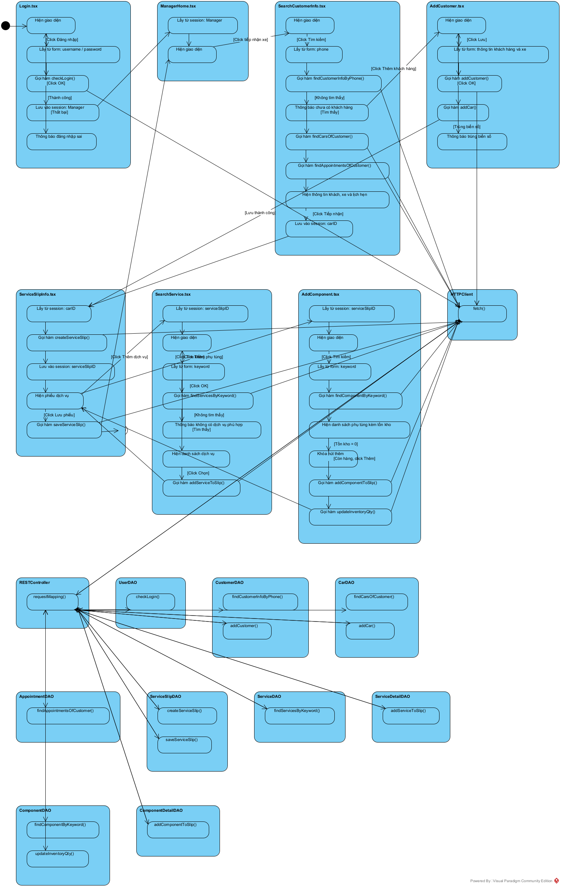
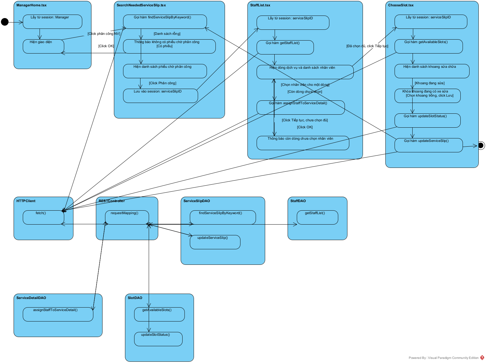
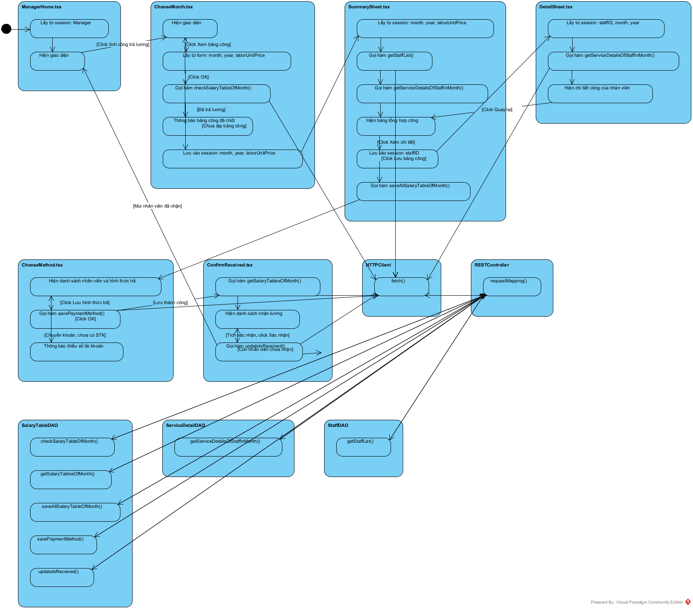

# Thiết kế biểu đồ hoạt động

- Bước 1: Với mỗi lớp giao diện đề xuất thành một activity.
- Bước 2: Với mỗi hoạt động đề xuất thành một action, rồi liên kết tuần tự các action.

---

## 1. Chức năng: Tiếp nhận xe của khách và chọn dịch vụ/phụ tùng

Bước 1 + 2: các activity đại diện cho các lớp giao diện, lớp HTTPClient, lớp
RESTController và các lớp DAO, kèm các action bên trong.

- Login.tsx
  - Hiện giao diện
  - Lấy từ form: username / password
  - Gọi hàm checkLogin()
  - Lưu vào session: Manager
  - Thông báo đăng nhập sai
- ManagerHome.tsx
  - Lấy từ session: Manager
  - Hiện giao diện
- SearchCustomerInfo.tsx
  - Hiện giao diện
  - Lấy từ form: phone
  - Gọi hàm findCustomerInfoByPhone()
  - Thông báo chưa có khách hàng
  - Gọi hàm findCarsOfCustomer()
  - Gọi hàm findAppointmentsOfCustomer()
  - Hiện thông tin khách, xe và lịch hẹn
  - Lưu vào session: carID
- AddCustomer.tsx
  - Hiện giao diện
  - Lấy từ form: thông tin khách hàng và xe
  - Gọi hàm addCustomer()
  - Gọi hàm addCar()
  - Thông báo trùng biển số
- ServiceSlipInfo.tsx
  - Lấy từ session: carID
  - Gọi hàm createServiceSlip()
  - Lưu vào session: serviceSlipID
  - Hiện phiếu dịch vụ
  - Gọi hàm saveServiceSlip()
- SearchService.tsx
  - Lấy từ session: serviceSlipID
  - Hiện giao diện
  - Lấy từ form: keyword
  - Gọi hàm findServicesByKeyword()
  - Thông báo không có dịch vụ phù hợp
  - Hiện danh sách dịch vụ
  - Gọi hàm addServiceToSlip()
- AddComponent.tsx
  - Lấy từ session: serviceSlipID
  - Hiện giao diện
  - Lấy từ form: keyword
  - Gọi hàm findComponentByKeyword()
  - Hiện danh sách phụ tùng kèm tồn kho
  - Khóa nút thêm
  - Gọi hàm addComponentToSlip()
  - Gọi hàm updateInventoryQty()
- HTTPClient
  - fetch()
- RESTController
  - requestMapping()
- UserDAO
  - checkLogin()
- CustomerDAO
  - findCustomerInfoByPhone()
  - addCustomer()
- CarDAO
  - findCarsOfCustomer()
  - addCar()
- AppointmentDAO
  - findAppointmentsOfCustomer()
- ServiceSlipDAO
  - createServiceSlip()
  - saveServiceSlip()
- ServiceDAO
  - findServicesByKeyword()
- ServiceDetailDAO
  - addServiceToSlip()
- ComponentDAO
  - findComponentByKeyword()
  - updateInventoryQty()
- ComponentDetailDAO
  - addComponentToSlip()

Ta được biểu đồ hoạt động:

---

## 2. Chức năng: Phân công nhân viên phục vụ

Bước 1 + 2: các activity đại diện cho các lớp giao diện, lớp HTTPClient, lớp
RESTController và các lớp DAO, kèm các action bên trong.

- ManagerHome.tsx
  - Lấy từ session: Manager
  - Hiện giao diện
- SearchNeededServiceSlip.tsx
  - Gọi hàm findServiceSlipByKeyword()
  - Thông báo không có phiếu chờ phân công
  - Hiện danh sách phiếu chờ phân công
  - Lưu vào session: serviceSlipID
- StaffList.tsx
  - Lấy từ session: serviceSlipID
  - Gọi hàm getStaffList()
  - Hiện dòng dịch vụ và danh sách nhân viên
  - Gọi hàm assignStaffToServiceDetail()
  - Thông báo còn dòng chưa chọn nhân viên
- ChooseSlot.tsx
  - Lấy từ session: serviceSlipID
  - Gọi hàm getAvailableSlots()
  - Hiện danh sách khoang sửa chữa
  - Khóa khoang đang có xe sửa
  - Gọi hàm updateSlotStatus()
  - Gọi hàm updateServiceSlip()
- HTTPClient
  - fetch()
- RESTController
  - requestMapping()
- ServiceSlipDAO
  - findServiceSlipByKeyword()
  - updateServiceSlip()
- StaffDAO
  - getStaffList()
- ServiceDetailDAO
  - assignStaffToServiceDetail()
- SlotDAO
  - getAvailableSlots()
  - updateSlotStatus()

Ta được biểu đồ hoạt động:

---

## 3. Chức năng: Tính công trả lương cho nhân viên phục vụ theo tháng

Bước 1 + 2: các activity đại diện cho các lớp giao diện, lớp HTTPClient, lớp
RESTController và các lớp DAO, kèm các action bên trong.

- ManagerHome.tsx
  - Lấy từ session: Manager
  - Hiện giao diện
- ChooseMonth.tsx
  - Hiện giao diện
  - Lấy từ form: month, year, laborUnitPrice
  - Gọi hàm checkSalaryTableOfMonth()
  - Thông báo bảng công đã chốt
  - Lưu vào session: month, year, laborUnitPrice
- SummarySheet.tsx
  - Lấy từ session: month, year, laborUnitPrice
  - Gọi hàm getStaffList()
  - Gọi hàm getServiceDetailsOfStaffInMonth()
  - Hiện bảng tổng hợp công
  - Lưu vào session: staffID
  - Gọi hàm saveAllSalaryTableOfMonth()
- DetailSheet.tsx
  - Lấy từ session: staffID, month, year
  - Gọi hàm getServiceDetailsOfStaffInMonth()
  - Hiện chi tiết công của nhân viên
- ChooseMethod.tsx
  - Hiện danh sách nhân viên và hình thức trả
  - Gọi hàm savePaymentMethod()
  - Thông báo thiếu số tài khoản
- ConfirmReceived.tsx
  - Gọi hàm getSalaryTablesOfMonth()
  - Hiện danh sách nhận lương
  - Gọi hàm updateIsReceived()
- HTTPClient
  - fetch()
- RESTController
  - requestMapping()
- SalaryTableDAO
  - checkSalaryTableOfMonth()
  - getSalaryTablesOfMonth()
  - saveAllSalaryTableOfMonth()
  - savePaymentMethod()
  - updateIsReceived()
- ServiceDetailDAO
  - getServiceDetailsOfStaffInMonth()
- StaffDAO
  - getStaffList()

Ta được biểu đồ hoạt động:

