# III. Thiết kế biểu đồ lớp chi tiết

- Framework sử dụng cho frontend: React TypeScript, mỗi màn hình là một file `.tsx`.
- Framework sử dụng cho backend: Spring Boot của Java, dùng JPA để thao tác với cơ sở dữ liệu.

---

## 1. Chức năng: Tiếp nhận xe của khách và chọn dịch vụ/phụ tùng

### a. Tầng giao diện

Tầng giao diện gồm các trang:

**Login.tsx: giao diện đăng nhập**

- Thuộc tính tường minh: `txtUsername: input`, `txtPassword: input`, `btnLogin: submit`
- Thuộc tính ẩn: không có.
- Gọi tới backend để kiểm tra đăng nhập.
  - Đăng nhập đúng thì điều hướng tới giao diện ManagerHome.
  - Đăng nhập sai thì hiện thông báo để quản lý nhập lại.

**ManagerHome.tsx: giao diện trang chủ của quản lý**

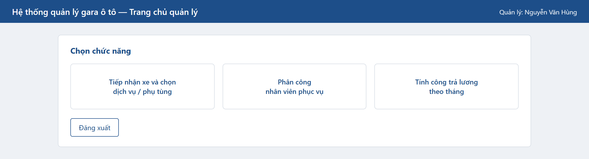

- Thuộc tính tường minh: `btnReceiveCar: link`, `btnAssignStaff: link`, `btnSalary: link`, `btnLogout: link`
- Thuộc tính ẩn: `m: Manager` (lấy từ session)
- Không cần gọi tới backend.
- Chọn chức năng tiếp nhận xe thì điều hướng tới trang SearchCustomerInfo.
- Chọn đăng xuất thì xóa thông tin quản lý khỏi session và quay về trang Login.

**SearchCustomerInfo.tsx: giao diện tra cứu khách hàng**

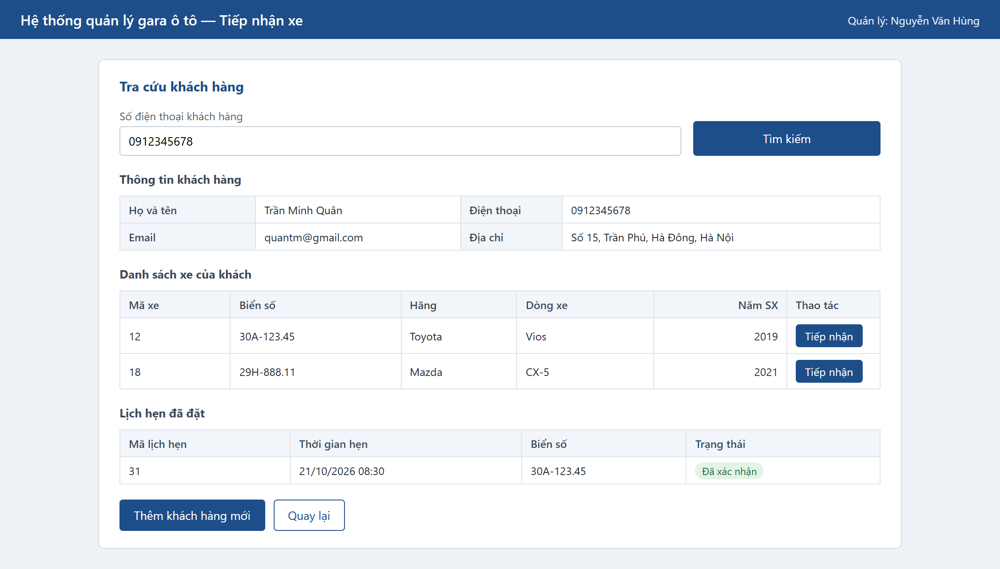

- Thuộc tính tường minh: `txtPhoneSearch: input`, `btnSearch: submit`, `tblCar: Table`, `tblAppointment: Table`, `btnAddCustomer: link`, `btnBack: link`
- Bảng `tblCar` gồm: carID, licensePlate, brand, model, year, btnReceive
- Bảng `tblAppointment` gồm: appointmentID, time, licensePlate, status
- Thuộc tính ẩn: `m: Manager`, `c: Customer`
- Gọi tới backend để tìm khách hàng theo số điện thoại, lấy danh sách xe và danh sách lịch hẹn của khách đó.
- Nếu số điện thoại chưa có trong hệ thống, hiện thông báo và gợi ý thêm khách hàng mới.
- Click nút tiếp nhận trên một dòng xe thì điều hướng tới giao diện ServiceSlipInfo của xe đó.
- Click nút thêm khách hàng mới thì điều hướng tới giao diện AddCustomer.
- Click nút quay lại thì về giao diện ManagerHome.

**AddCustomer.tsx: giao diện thêm khách hàng và xe mới**

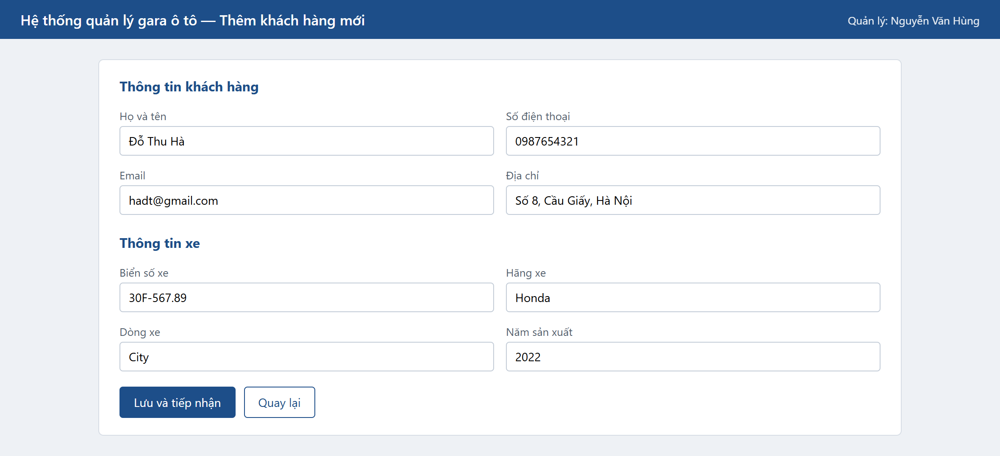

- Thuộc tính tường minh: `txtFullname: input`, `txtPhone: input`, `txtEmail: input`, `txtAddress: input`, `txtLicensePlate: input`, `txtBrand: input`, `txtModel: input`, `txtYear: input`, `btnSave: submit`, `btnBack: link`
- Thuộc tính ẩn: `m: Manager`
- Gọi tới backend để lưu khách hàng mới, sau đó lưu xe gắn với khách hàng vừa tạo.
- Nếu biển số xe đã tồn tại trong hệ thống, hiện thông báo và không lưu.
- Lưu thành công thì tạo phiếu dịch vụ và điều hướng tới giao diện ServiceSlipInfo.
- Click nút quay lại thì về giao diện SearchCustomerInfo.

**ServiceSlipInfo.tsx: giao diện phiếu dịch vụ**

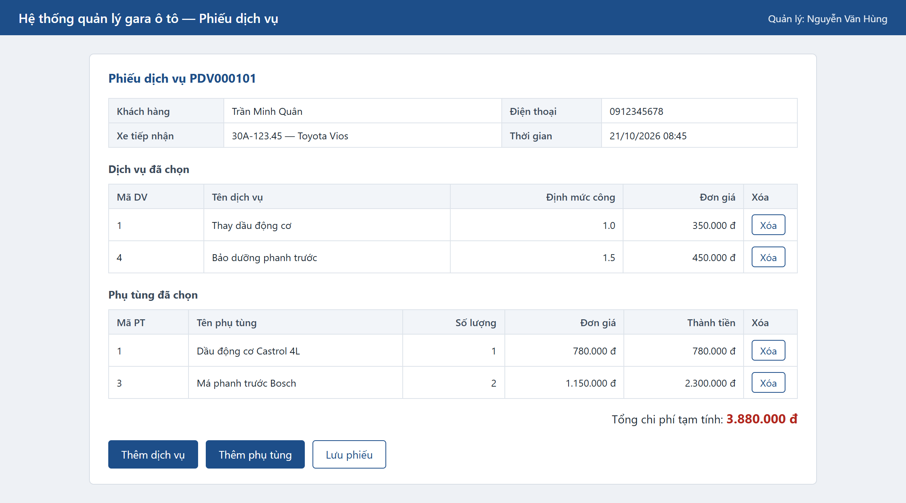

- Thuộc tính tường minh: `tblServiceDetail: Table`, `tblComponentDetail: Table`, `outTotalCost: TextField`, `btnAddService: link`, `btnAddComponent: link`, `btnSave: submit`
- Bảng `tblServiceDetail` gồm: serviceID, name, laborContent, price, btnDelete
- Bảng `tblComponentDetail` gồm: componentID, name, qty, price, thành tiền, btnDelete
- Thuộc tính ẩn: `ss: ServiceSlip`, `car: Car`, `c: Customer`, `m: Manager`
- Gọi tới backend để tạo phiếu dịch vụ khi vào trang lần đầu, và để lưu phiếu khi quản lý bấm nút lưu.
- Tổng chi phí tạm tính được tính lại mỗi lần thêm hoặc xóa một dòng dịch vụ, phụ tùng.
- Click thêm dịch vụ thì điều hướng tới giao diện SearchService.
- Click thêm phụ tùng thì điều hướng tới giao diện AddComponent.
- Lưu phiếu thành công thì quay về giao diện ManagerHome.

**SearchService.tsx: giao diện chọn dịch vụ**

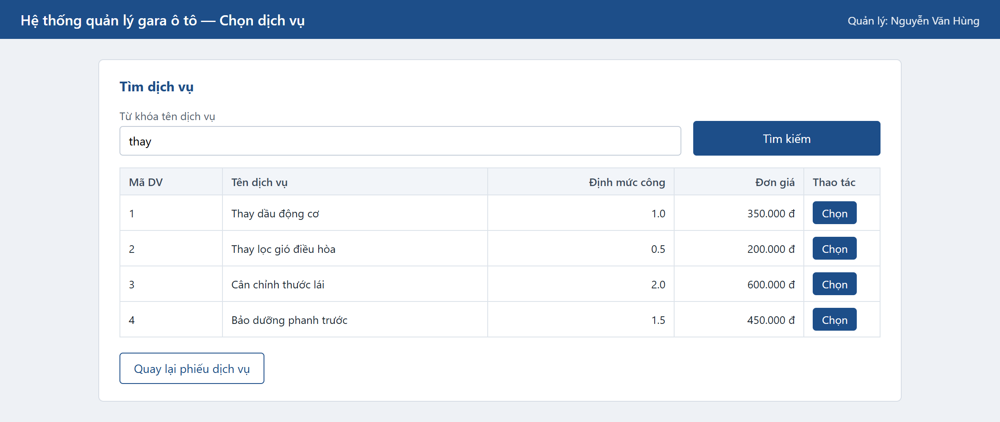

- Thuộc tính tường minh: `txtServiceKeyword: input`, `btnSearch: submit`, `tblService: Table`, `btnBack: link`
- Bảng `tblService` gồm: serviceID, name, laborContent, price, btnChoose
- Thuộc tính ẩn: `ss: ServiceSlip`, `m: Manager`
- Gọi tới backend để tìm dịch vụ theo từ khóa tên dịch vụ.
- Nếu không tìm được dịch vụ phù hợp, hiện thông báo không có dịch vụ nào khớp.
- Click nút chọn thì gọi backend thêm dòng dịch vụ vào phiếu, rồi quay về giao diện ServiceSlipInfo.

**AddComponent.tsx: giao diện chọn phụ tùng**

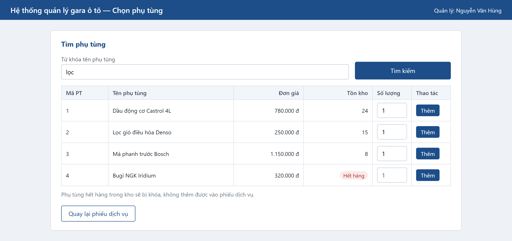

- Thuộc tính tường minh: `txtComponentKeyword: input`, `btnSearch: submit`, `tblComponent: Table`, `txtQty: input`, `btnBack: link`
- Bảng `tblComponent` gồm: componentID, name, price, inventoryQty, txtQty, btnAdd
- Thuộc tính ẩn: `ss: ServiceSlip`, `m: Manager`
- Gọi tới backend để tìm phụ tùng theo từ khóa, kèm số lượng tồn kho.
- Phụ tùng có tồn kho bằng 0 thì ô số lượng và nút thêm bị khóa.
- Nếu số lượng nhập vượt quá tồn kho, hiện thông báo và không thêm.
- Click nút thêm thì gọi backend thêm dòng phụ tùng vào phiếu, trừ tồn kho tương ứng, rồi quay về giao diện ServiceSlipInfo.

**Quan hệ giữa các giao diện:**

- Login.tsx liên kết với ManagerHome.tsx.
- ManagerHome.tsx liên kết với SearchCustomerInfo.tsx.
- SearchCustomerInfo.tsx liên kết với AddCustomer.tsx và ServiceSlipInfo.tsx.
- ServiceSlipInfo.tsx liên kết với SearchService.tsx và AddComponent.tsx.

Ta được sơ đồ luồng màn hình:

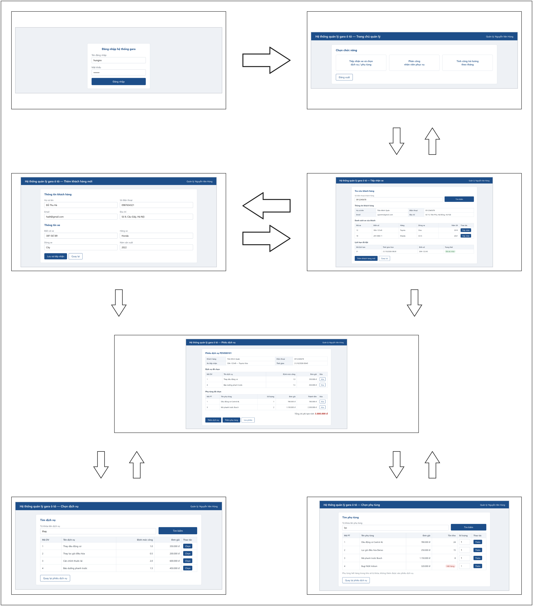

### b. Tầng thao tác cơ sở dữ liệu

Gồm các lớp DAO. Lớp `DAO` cung cấp kết nối chung cho tất cả lớp kế thừa trong hệ thống, phần kết nối do Spring Boot tự thực hiện qua cấu hình.

- `UserDAO`: lớp thao tác với cơ sở dữ liệu liên quan đến lớp User.
  - Phương thức: checkLogin
    - Input: `User`
    - Output: `User`
- `CustomerDAO`: lớp thao tác với cơ sở dữ liệu liên quan đến lớp Customer.
  - Phương thức: findCustomerInfoByPhone
    - Input: `phone (string)`
    - Output: `Customer`
  - Phương thức: addCustomer
    - Input: `Customer`
    - Output: `Customer`
- `CarDAO`: lớp thao tác với cơ sở dữ liệu liên quan đến lớp Car.
  - Phương thức: findCarsOfCustomer
    - Input: `customerID (int)`
    - Output: `List<Car>`
  - Phương thức: addCar
    - Input: `Car`
    - Output: `Car`
- `AppointmentDAO`: lớp thao tác với cơ sở dữ liệu liên quan đến lớp Appointment.
  - Phương thức: findAppointmentsOfCustomer
    - Input: `customerID (int)`
    - Output: `List<Appointment>`
- `ServiceSlipDAO`: lớp thao tác với cơ sở dữ liệu liên quan đến lớp ServiceSlip.
  - Phương thức: createServiceSlip
    - Input: `ServiceSlip`
    - Output: `ServiceSlip`
  - Phương thức: saveServiceSlip
    - Input: `ServiceSlip`
    - Output: `void`
- `ServiceDAO`: lớp thao tác với cơ sở dữ liệu liên quan đến lớp Service.
  - Phương thức: findServicesByKeyword
    - Input: `keyword (string)`
    - Output: `List<Service>`
- `ServiceDetailDAO`: lớp thao tác với cơ sở dữ liệu liên quan đến lớp ServiceDetail.
  - Phương thức: addServiceToSlip
    - Input: `ServiceDetail`
    - Output: `void`
- `ComponentDAO`: lớp thao tác với cơ sở dữ liệu liên quan đến lớp Component.
  - Phương thức: findComponentByKeyword
    - Input: `keyword (string)`
    - Output: `List<Component>`
  - Phương thức: updateInventoryQty
    - Input: `componentID (int), qty (int)`
    - Output: `void`
- `ComponentDetailDAO`: lớp thao tác với cơ sở dữ liệu liên quan đến lớp ComponentDetail.
  - Phương thức: addComponentToSlip
    - Input: `ComponentDetail`
    - Output: `void`

### c. Tầng thực thể

Gồm các lớp thực thể trong chức năng tiếp nhận xe: User, Customer, Car, Appointment, ServiceSlip, ServiceDetail, Service, ComponentDetail và Component.

### d. Các lớp phụ trợ

- `HTTPClient`: chứa phương thức `fetch` giúp gọi API từ phía frontend tới backend.
- `RESTController`: giúp backend điều hướng yêu cầu gọi API từ frontend tới lớp DAO phù hợp.

Ta được biểu đồ lớp:

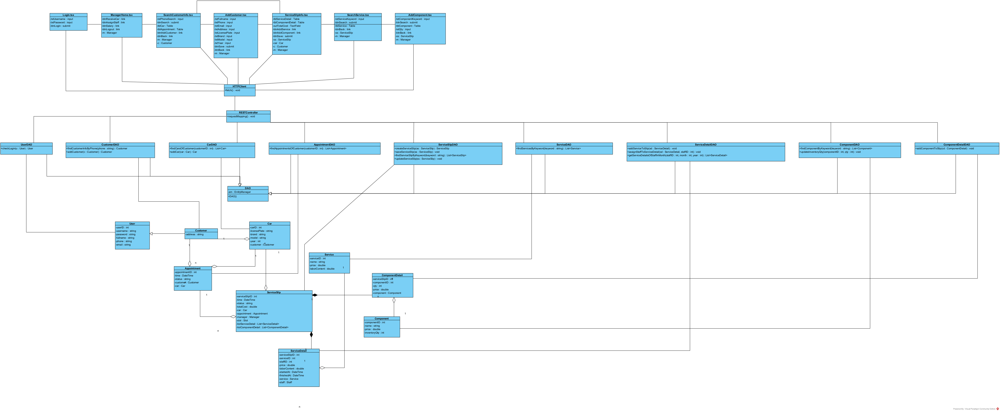

---

## 2. Chức năng: Phân công nhân viên phục vụ

### a. Tầng giao diện

Tầng giao diện gồm các trang:

**ManagerHome.tsx: giao diện trang chủ của quản lý, giống phần trên**

- Chọn chức năng phân công nhân viên thì điều hướng tới trang SearchNeededServiceSlip.

**SearchNeededServiceSlip.tsx: giao diện danh sách phiếu chờ phân công**

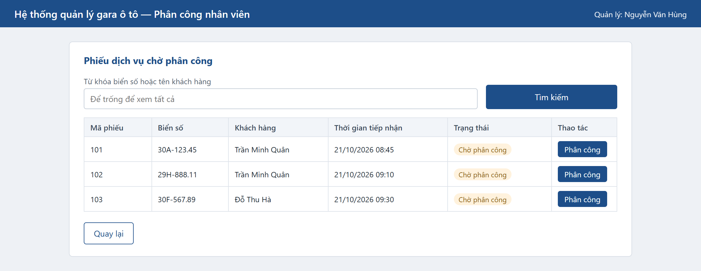

- Thuộc tính tường minh: `txtSlipKeyword: input`, `btnSearch: submit`, `tblServiceSlip: Table`, `btnBack: link`
- Bảng `tblServiceSlip` gồm: serviceSlipID, licensePlate, tên khách hàng, time, status, btnAssign
- Thuộc tính ẩn: `m: Manager`
- Gọi tới backend để lấy danh sách phiếu dịch vụ đang ở trạng thái chờ phân công, lọc theo biển số hoặc tên khách hàng.
- Nếu không có phiếu nào chờ phân công, hiện thông báo danh sách rỗng.
- Click nút phân công trên một dòng thì điều hướng tới giao diện StaffList của phiếu đó.
- Click nút quay lại thì về giao diện ManagerHome.

**StaffList.tsx: giao diện chọn nhân viên phục vụ**

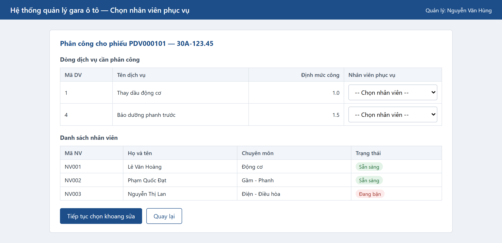

- Thuộc tính tường minh: `tblServiceDetail: Table`, `tblStaff: Table`, `cboStaff: select`, `btnNext: link`, `btnBack: link`
- Bảng `tblServiceDetail` gồm: serviceID, name, laborContent, cboStaff
- Bảng `tblStaff` gồm: employeeCode, fullname, specialization, trạng thái bận hay rảnh
- Thuộc tính ẩn: `ss: ServiceSlip`, `m: Manager`
- Gọi tới backend để lấy danh sách dòng dịch vụ của phiếu và danh sách nhân viên phục vụ kèm trạng thái.
- Nhân viên đang bận không xuất hiện trong ô chọn của từng dòng dịch vụ.
- Nếu còn dòng dịch vụ chưa chọn nhân viên, hiện thông báo và không cho sang bước tiếp theo.
- Click nút tiếp tục thì điều hướng tới giao diện ChooseSlot.
- Click nút quay lại thì về giao diện SearchNeededServiceSlip.

**ChooseSlot.tsx: giao diện chọn khoang sửa chữa**

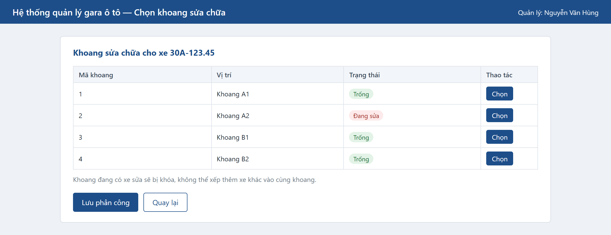

- Thuộc tính tường minh: `tblSlot: Table`, `btnSave: submit`, `btnBack: link`
- Bảng `tblSlot` gồm: slotID, location, status, btnChoose
- Thuộc tính ẩn: `ss: ServiceSlip`, `m: Manager`
- Gọi tới backend để lấy danh sách khoang sửa chữa kèm trạng thái.
- Khoang đang có xe sửa thì nút chọn bị khóa, không xếp thêm xe khác vào cùng một khoang.
- Nếu không còn khoang trống, hiện thông báo và quản lý phải chờ hoặc chọn phiếu khác.
- Click nút lưu thì gọi backend gán nhân viên cho từng dòng dịch vụ, gán khoang cho phiếu, chuyển trạng thái khoang sang đang sửa và trạng thái phiếu sang đang thực hiện, rồi quay về giao diện SearchNeededServiceSlip.
- Click nút quay lại thì về giao diện StaffList.

**Quan hệ giữa các giao diện:**

- ManagerHome.tsx liên kết với SearchNeededServiceSlip.tsx.
- SearchNeededServiceSlip.tsx liên kết với StaffList.tsx.
- StaffList.tsx liên kết với ChooseSlot.tsx.

Ta được sơ đồ luồng màn hình:

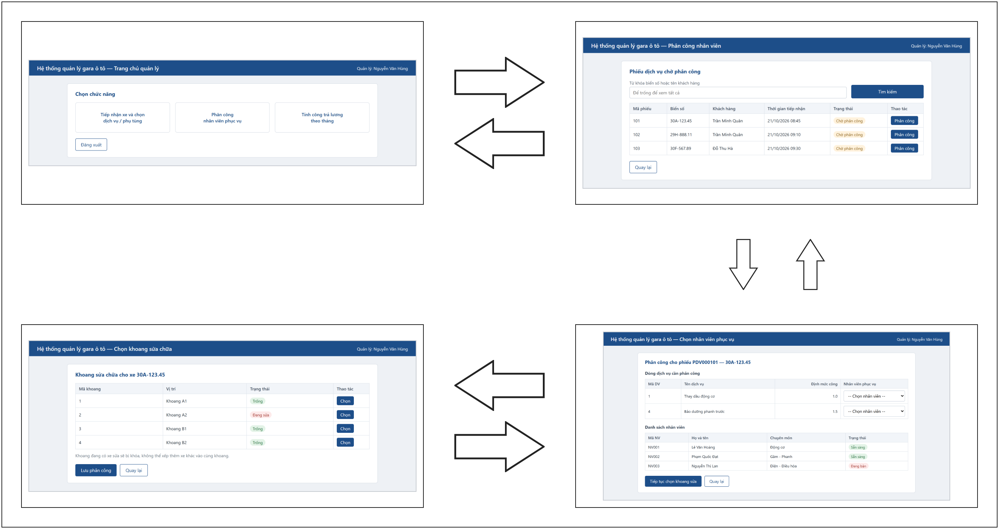

### b. Tầng thao tác cơ sở dữ liệu

- `ServiceSlipDAO`: lớp thao tác với cơ sở dữ liệu liên quan đến lớp ServiceSlip.
  - Phương thức: findServiceSlipByKeyword
    - Input: `keyword (string)`
    - Output: `List<ServiceSlip>`
  - Phương thức: updateServiceSlip
    - Input: `ServiceSlip`
    - Output: `void`
- `StaffDAO`: lớp thao tác với cơ sở dữ liệu liên quan đến lớp Staff.
  - Phương thức: getStaffList
    - Input: không có
    - Output: `List<Staff>`
- `ServiceDetailDAO`: lớp thao tác với cơ sở dữ liệu liên quan đến lớp ServiceDetail.
  - Phương thức: assignStaffToServiceDetail
    - Input: `ServiceDetail, staffID (int)`
    - Output: `void`
- `SlotDAO`: lớp thao tác với cơ sở dữ liệu liên quan đến lớp Slot.
  - Phương thức: getAvailableSlots
    - Input: không có
    - Output: `List<Slot>`
  - Phương thức: updateSlotStatus
    - Input: `slotID (int), status (string)`
    - Output: `void`

### c. Tầng thực thể

Gồm các lớp thực thể trong chức năng phân công nhân viên phục vụ: User, Manager, Staff, Car, ServiceSlip, ServiceDetail, Service và Slot.

### d. Các lớp phụ trợ

- `HTTPClient`: chứa phương thức `fetch` giúp gọi API từ phía frontend tới backend.
- `RESTController`: giúp backend điều hướng yêu cầu gọi API từ frontend tới lớp DAO phù hợp.

Ta được biểu đồ lớp:

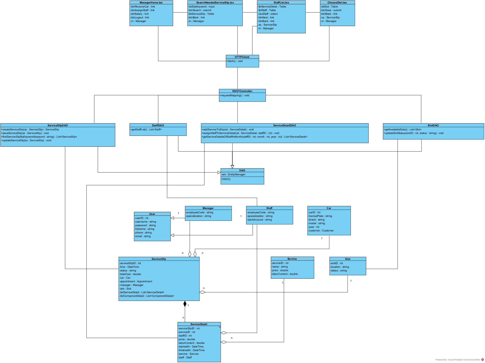

---

## 3. Chức năng: Tính công trả lương cho nhân viên phục vụ theo tháng

### a. Tầng giao diện

Tầng giao diện gồm các trang:

**ManagerHome.tsx: giao diện trang chủ của quản lý, giống phần trên**

- Chọn chức năng tính công trả lương thì điều hướng tới trang ChooseMonth.

**ChooseMonth.tsx: giao diện chọn kỳ tính lương**

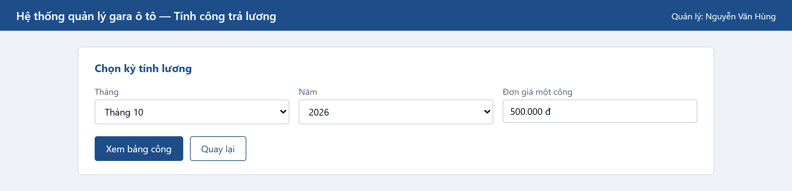

- Thuộc tính tường minh: `txtMonth: select`, `txtYear: select`, `txtLaborUnitPrice: input`, `btnView: submit`, `btnBack: link`
- Thuộc tính ẩn: `m: Manager`
- Gọi tới backend để kiểm tra bảng công của tháng được chọn đã được lập hay chưa.
- Nếu bảng công tháng đó đã lập và đã trả lương, hiện thông báo và chỉ cho xem lại, không cho tính lại.
- Click nút xem bảng công thì điều hướng tới giao diện SummarySheet.
- Click nút quay lại thì về giao diện ManagerHome.

**SummarySheet.tsx: giao diện bảng tổng hợp công**

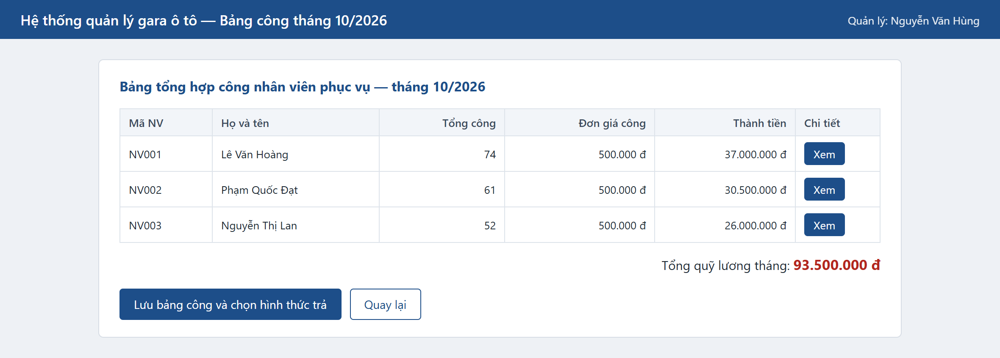

- Thuộc tính tường minh: `tblSalaryTable: Table`, `outTotalAmount: TextField`, `btnSaveAll: submit`, `btnBack: link`
- Bảng `tblSalaryTable` gồm: employeeCode, fullname, tổng công, đơn giá công, thành tiền, btnDetail
- Thuộc tính ẩn: `m: Manager`
- Gọi tới backend để lấy tổng định mức công của từng nhân viên trong tháng, rồi nhân với đơn giá một công để ra thành tiền.
- Nhân viên không có dòng dịch vụ nào hoàn thành trong tháng thì tổng công bằng 0 và vẫn hiện trong bảng.
- Click nút xem chi tiết của một nhân viên thì điều hướng tới giao diện DetailSheet.
- Click nút lưu bảng công thì gọi backend lưu toàn bộ bảng công của tháng, rồi điều hướng tới giao diện ChooseMethod.
- Click nút quay lại thì về giao diện ChooseMonth.

**DetailSheet.tsx: giao diện chi tiết công của một nhân viên**

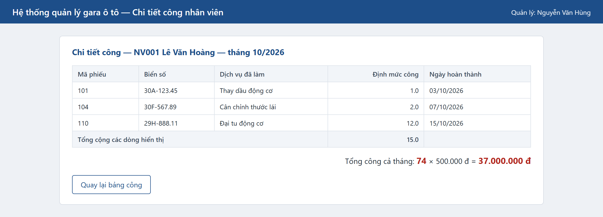

- Thuộc tính tường minh: `tblServiceDetail: Table`, `outTotalLabor: TextField`, `btnBack: link`
- Bảng `tblServiceDetail` gồm: serviceSlipID, licensePlate, tên dịch vụ, laborContent, finishedAt
- Thuộc tính ẩn: `st: Staff`, `m: Manager`
- Gọi tới backend để lấy danh sách dòng dịch vụ mà nhân viên đó đã hoàn thành trong tháng.
- Click nút quay lại thì về giao diện SummarySheet.

**ChooseMethod.tsx: giao diện chọn hình thức trả lương**

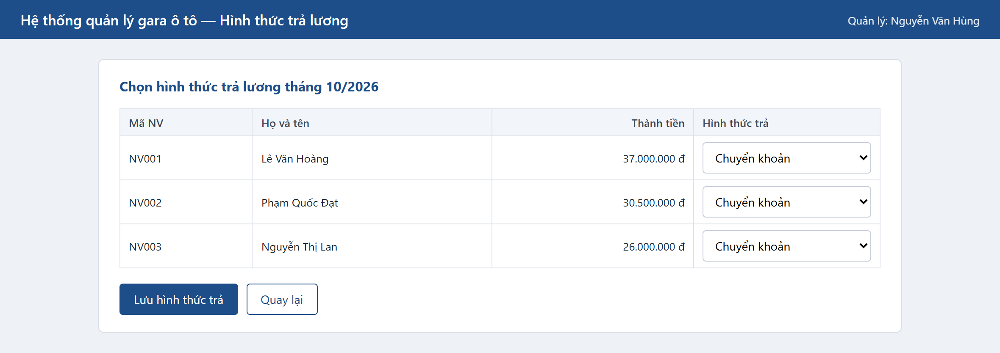

- Thuộc tính tường minh: `tblSalaryTable: Table`, `cboPaymentMethod: select`, `btnSaveMethod: submit`, `btnBack: link`
- Bảng `tblSalaryTable` gồm: employeeCode, fullname, thành tiền, cboPaymentMethod
- Thuộc tính ẩn: `m: Manager`
- Gọi tới backend để lưu hình thức trả lương của từng nhân viên.
- Nhân viên chọn hình thức chuyển khoản mà chưa có số tài khoản thì hiện thông báo và yêu cầu bổ sung.
- Lưu xong thì điều hướng tới giao diện ConfirmReceived.
- Click nút quay lại thì về giao diện SummarySheet.

**ConfirmReceived.tsx: giao diện xác nhận đã nhận lương**

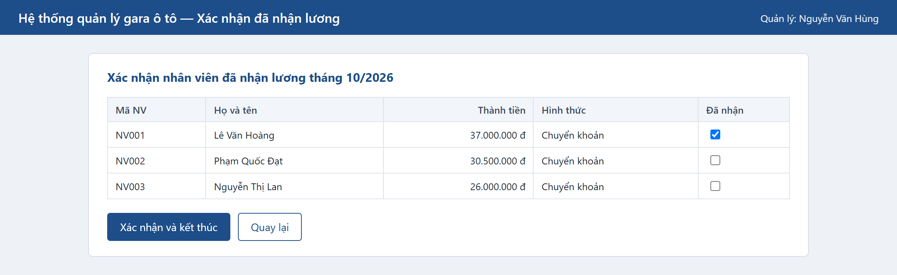

- Thuộc tính tường minh: `tblSalaryTable: Table`, `chkIsReceived: checkbox`, `btnConfirm: submit`, `btnBack: link`
- Bảng `tblSalaryTable` gồm: employeeCode, fullname, thành tiền, hình thức trả, chkIsReceived
- Thuộc tính ẩn: `m: Manager`
- Gọi tới backend để cập nhật trạng thái đã nhận lương của từng nhân viên.
- Khi toàn bộ nhân viên đã xác nhận nhận lương, bảng công của tháng chuyển sang trạng thái hoàn tất và không sửa được nữa.
- Click nút xác nhận thì lưu lại và quay về giao diện ManagerHome.
- Click nút quay lại thì về giao diện ChooseMethod.

**Quan hệ giữa các giao diện:**

- ManagerHome.tsx liên kết với ChooseMonth.tsx.
- ChooseMonth.tsx liên kết với SummarySheet.tsx.
- SummarySheet.tsx liên kết với DetailSheet.tsx và ChooseMethod.tsx.
- ChooseMethod.tsx liên kết với ConfirmReceived.tsx.

Ta được sơ đồ luồng màn hình:

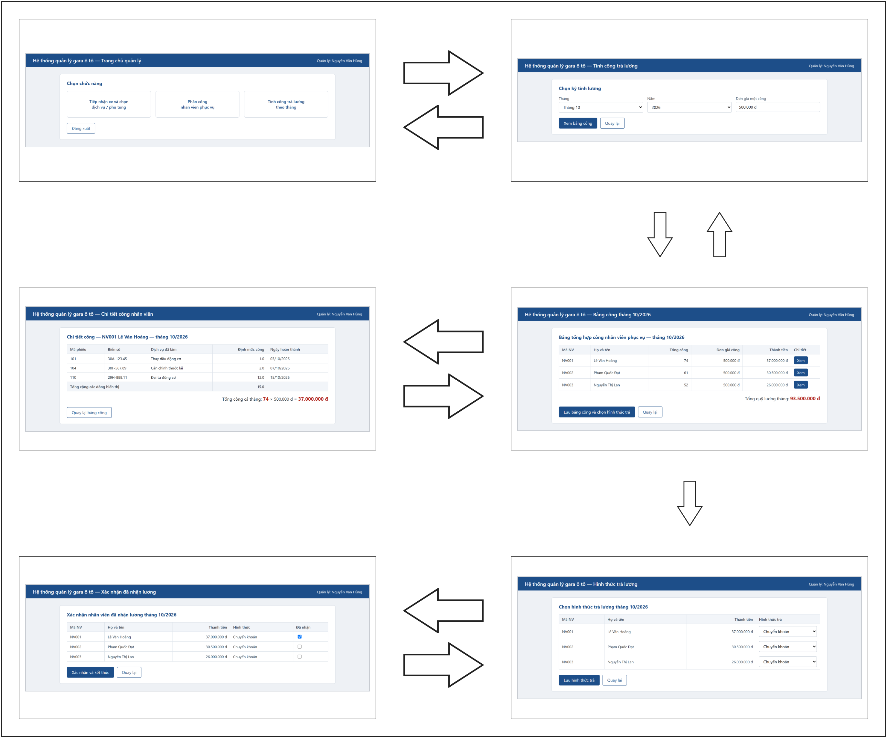

### b. Tầng thao tác cơ sở dữ liệu

- `SalaryTableDAO`: lớp thao tác với cơ sở dữ liệu liên quan đến lớp SalaryTable.
  - Phương thức: checkSalaryTableOfMonth
    - Input: `month (int), year (int)`
    - Output: `boolean`
  - Phương thức: getSalaryTablesOfMonth
    - Input: `month (int), year (int)`
    - Output: `List<SalaryTable>`
  - Phương thức: saveAllSalaryTableOfMonth
    - Input: `List<SalaryTable>`
    - Output: `void`
  - Phương thức: savePaymentMethod
    - Input: `SalaryTable`
    - Output: `void`
  - Phương thức: updateIsReceived
    - Input: `SalaryTable`
    - Output: `void`
- `ServiceDetailDAO`: lớp thao tác với cơ sở dữ liệu liên quan đến lớp ServiceDetail.
  - Phương thức: getServiceDetailsOfStaffInMonth
    - Input: `staffID (int), month (int), year (int)`
    - Output: `List<ServiceDetail>`
- `StaffDAO`: lớp thao tác với cơ sở dữ liệu liên quan đến lớp Staff.
  - Phương thức: getStaffList
    - Input: không có
    - Output: `List<Staff>`

### c. Tầng thực thể

Gồm các lớp thực thể trong chức năng tính công trả lương: User, Manager, Staff, SalaryTable, ServiceDetail, ServiceSlip và Service.

### d. Các lớp phụ trợ

- `HTTPClient`: chứa phương thức `fetch` giúp gọi API từ phía frontend tới backend.
- `RESTController`: giúp backend điều hướng yêu cầu gọi API từ frontend tới lớp DAO phù hợp.

Ta được biểu đồ lớp:

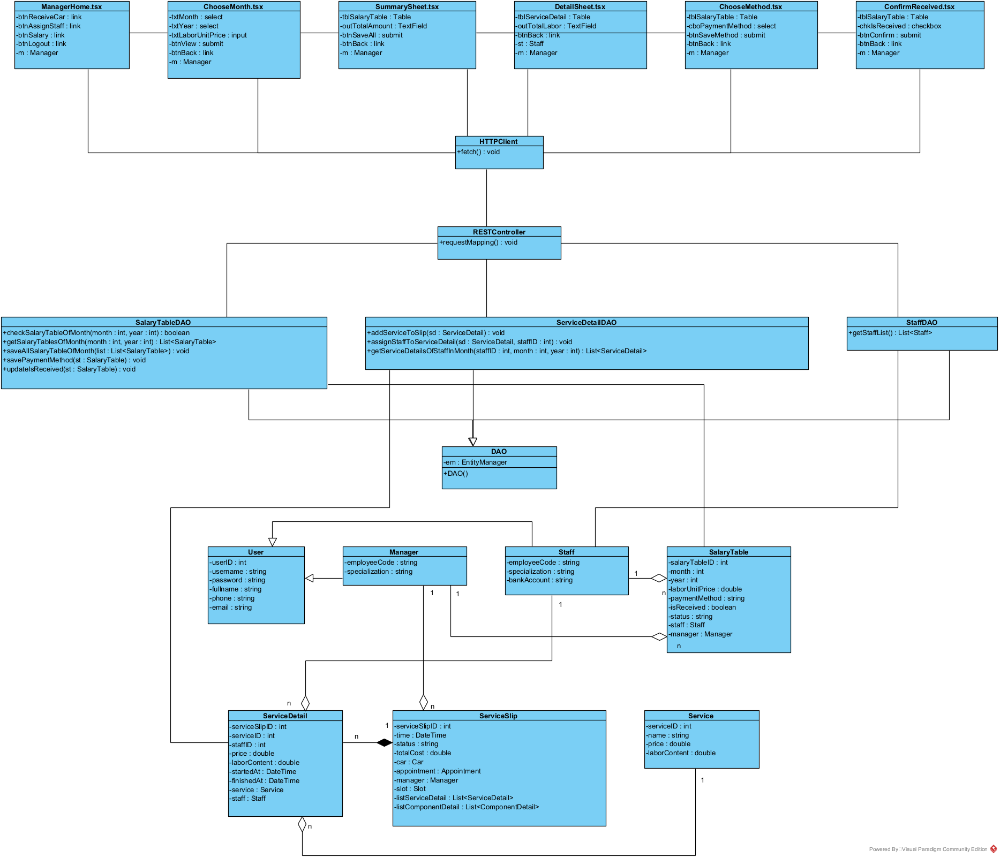
